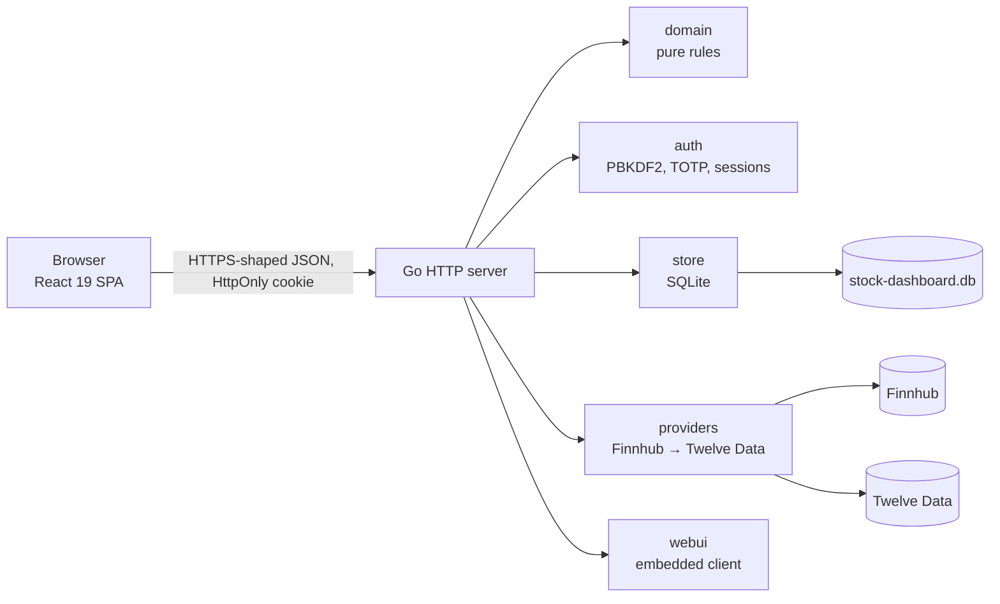

# Candidate Submission — Stock Dashboard (Go + React)

**Repository:** <https://github.com/Roy0902/stock-dashboard-go> (public)
**Stack:** Go 1.27, React 19 + TypeScript, SQLite, Playwright, Docker
**Scope:** a local, multi-account stock watchlist with quotes, fallback providers, daily charts,
TOTP authentication and a tested HTTP contract.

This file is the reviewer entry point. The full developer documentation is in
[`README.md`](README.md), and the AI-assisted workflow is in
[`docs/submission/ai-workflow.md`](docs/submission/ai-workflow.md).

## Quick start

### Docker (recommended for review)

```bash
git clone https://github.com/Roy0902/stock-dashboard-go.git
cd stock-dashboard-go
cp .env.example .env          # add FINNHUB_API_KEY and TWELVEDATA_API_KEY
docker compose up -d --build
# open http://127.0.0.1:3000
```

The container runs non-root on a distroless image, publishes on host loopback only, and keeps
SQLite in a named volume. Without API keys the app still starts and shows the missing-key message.

### Local

```powershell
Copy-Item .env.example .env   # add both keys
powershell -ExecutionPolicy Bypass -File scripts/start.ps1
```

Open <http://127.0.0.1:3000/setup> on first run to create the first account. Both provider keys
are free-tier: [Finnhub](https://finnhub.io/register) and
[Twelve Data](https://twelvedata.com/register).

## What to look at

1. **First-run setup** — create an account, scan the TOTP QR, save the ten recovery codes.
2. **Dashboard** — add `AAPL` and `MSFT`; each row shows price, change, percent, direction,
   provider, timestamp and a chart link. Quotes refresh every 60 seconds while the tab is visible.
3. **Fallback** — unset `FINNHUB_API_KEY` and restart; quotes are attributed to `Twelve Data`.
   Unset both keys and the dashboard explains the missing configuration without crashing.
4. **Chart** — open `View chart`; switch `1M`, `3M`, `1Y`. The SVG has an accessible name and text
   description, and a successful empty series says `No data for this range`.
5. **Security surface** — `/api/watchlist` returns `401` without a session; passwords are PBKDF2,
   TOTP secrets never reach the client, and unsafe methods are Origin-checked.

## Architecture



Full diagrams, including the quote-fallback sequence and deployment: [`docs/submission/architecture.md`](docs/submission/architecture.md).

## How AI was used

The project was delivered through a **spec-first, review-gated loop** rather than one-shot
generation:

- A frozen plan and contracts were written before code; acceptance tests were authored red first.
- **Nine delegated agent runs** produced four independent reviews and five implementation passes.
- Reviews were treated as evidence, not authority: every claim was re-checked, and two defects the
  reviews themselves introduced were found and fixed in a final adversarial pass.
- Verification was mechanical: Go vet/tests, 131 web tests, 33 Playwright journeys, a real Docker
  build and a live container smoke test.

The full account, including the measured time span and token usage, is in
[`docs/submission/ai-workflow.md`](docs/submission/ai-workflow.md).

## Verification evidence

Reproduced on 2026-11-19 from a clean checkout:

| Gate | Command | Result |
| :-- | :-- | :-- |
| Go format / vet / build | `gofmt -l .`, `go vet ./...`, `go build ./...` | clean |
| Go tests | `go test ./... -count=1` | 8 packages pass |
| Web types / lint / format | `npm run typecheck`, `lint`, `format:check` | pass |
| Web tests | `npm run test` | **131 pass** (19 files) |
| Acceptance | `npm test` in `e2e/` | **33 pass** |
| One-shot gate | `scripts/verify.ps1` | `All gates passed.` |
| Container | `docker build`, `docker compose up` | healthy, 32 MB, non-root, `401` without session |

Evidence and dispositions: [`docs/verification.md`](docs/verification.md),
[`docs/reviews/`](docs/reviews/), and [`docs/quality-gates.md`](docs/quality-gates.md).

## Deliberate trade-offs

- **No UI remove control.** The contract exposes `DELETE /api/watchlist/{ticker}` and tests it;
  the frozen plan has no UI scenario for removal.
- **Sessions live in memory.** A restart asks users to sign in again; only the SQLite data survives.
- **TOTP seeds are stored in SQLite in plaintext.** File permissions are `0600`, but encryption at
  rest needs a key-management decision. This is recorded, not hidden.
- **`go test -race` is not in the default gate on this host** because cgo is unavailable; the
  command and the reason are documented. Run it on a cgo toolchain before production use.
- **Light theme follows `prefers-color-scheme`**; there is no in-app theme toggle.

## Repository map

| Path | Contents |
| :-- | :-- |
| `server/` | Go API, domain, auth, providers, SQLite store, embedded UI |
| `web/` | React client, components, locale, unit/component tests |
| `e2e/` | Playwright acceptance journeys and fake providers |
| `spec/` | frozen plan, scenarios, checklists, review records, as-built diagram |
| `docs/` | contracts, decisions, architecture, quality gates, reviews, this submission |
| `Dockerfile`, `docker-compose.yml` | multi-stage image and loopback-only runtime |
