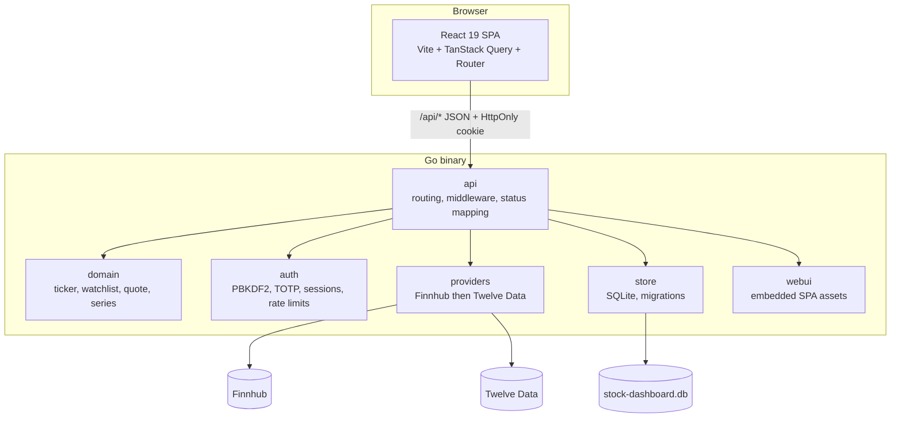
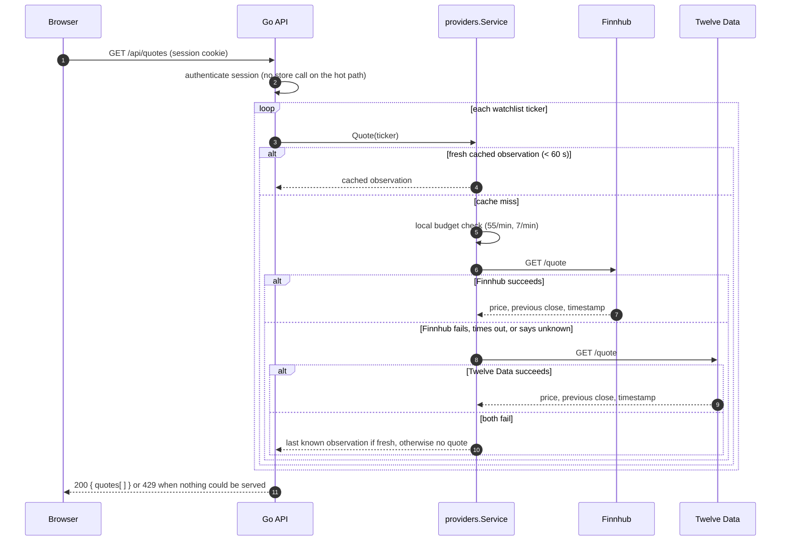
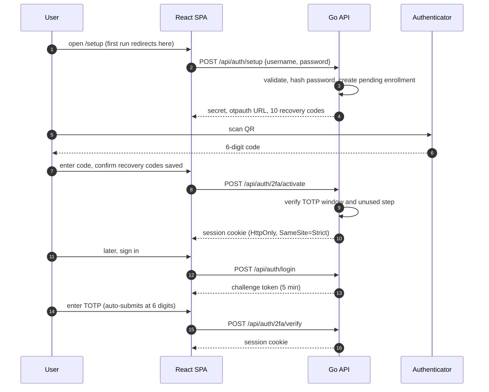
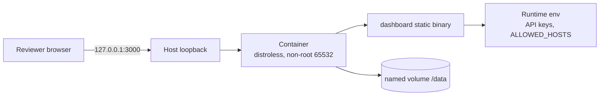
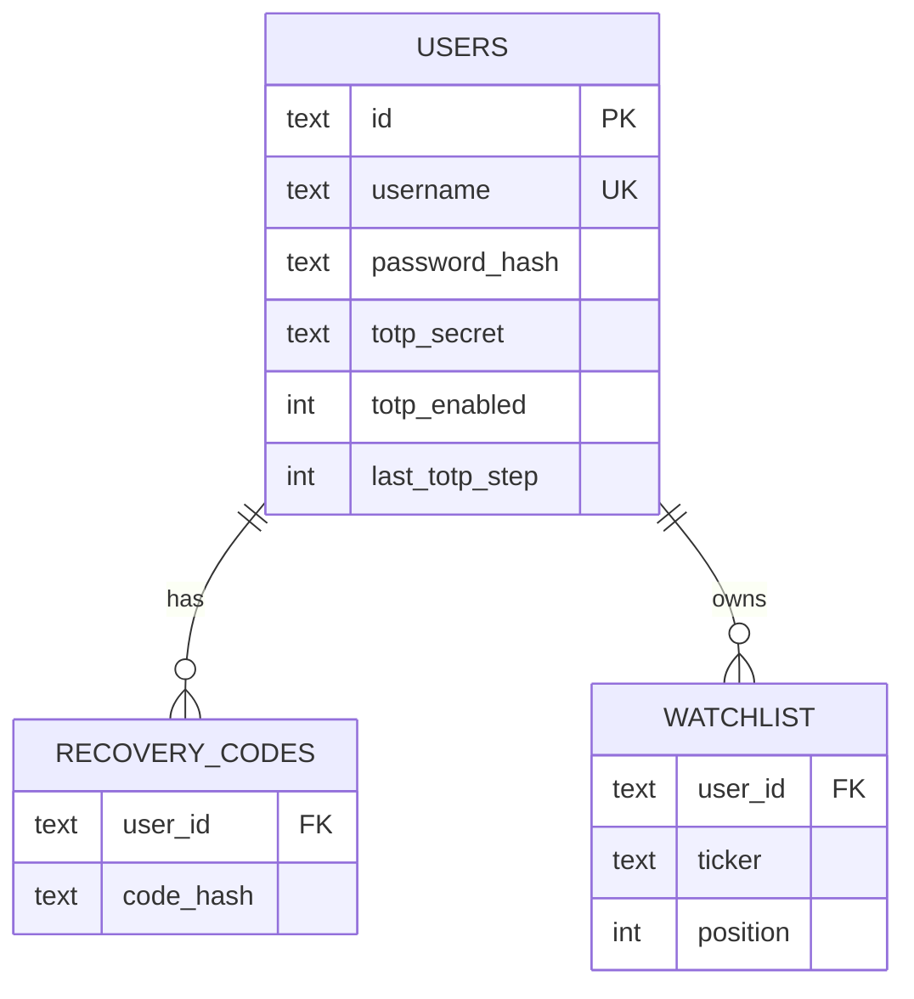

# Architecture and demonstration diagrams

Companion to [`../architecture.md`](../architecture.md). These are the diagrams a reviewer can
follow without reading the code.

Key decisions visible in the diagrams:

- **PBKDF2-HMAC-SHA256 (600,000 iterations) for new passwords**, chosen over Argon2id after
  weighing memory cost and denial-of-service exposure; legacy Argon2 hashes verify and rehash.
- **Mandatory TOTP and single-use recovery codes**, with each account owning a separate watchlist.
- **SQLite is the only persisted state**; sessions and provider caches stay in memory.
- **The client never recomputes derived quote values**; change, percent, direction and staleness
  come from the API.
- **The container is distroless and non-root**, listens on `0.0.0.0` internally and is published
  only on host `127.0.0.1`.

## Components

Dependency direction is one-way: `api → {auth, domain, providers, store}`;
`auth → domain` and defines the `UserStore` port; `store → {auth, domain}`;
`providers → domain`; `domain → standard library only`.

## Quote request, cache and fallback

Derived change, percent, direction and staleness are computed once in `domain.DeriveQuote`. The
client renders those values; it never recomputes them.

## Setup and sign-in

Unsafe API calls require a same-origin `Origin`; every `/api` route is guarded by a public
allowlist, so a newly added route cannot ship unauthenticated by accident.

## Deployment

The image is multi-stage: Node builds the SPA, Go builds one static binary with the SPA embedded,
and the distroless runtime contains only the binary, the healthcheck and an empty `/data` volume.
The container listens on `0.0.0.0` internally and is published only on host `127.0.0.1`.

## Persistence

Only `stock-dashboard.db` persists. Sessions and quote/chart caches are in memory, so a restart
requires signing in again.
