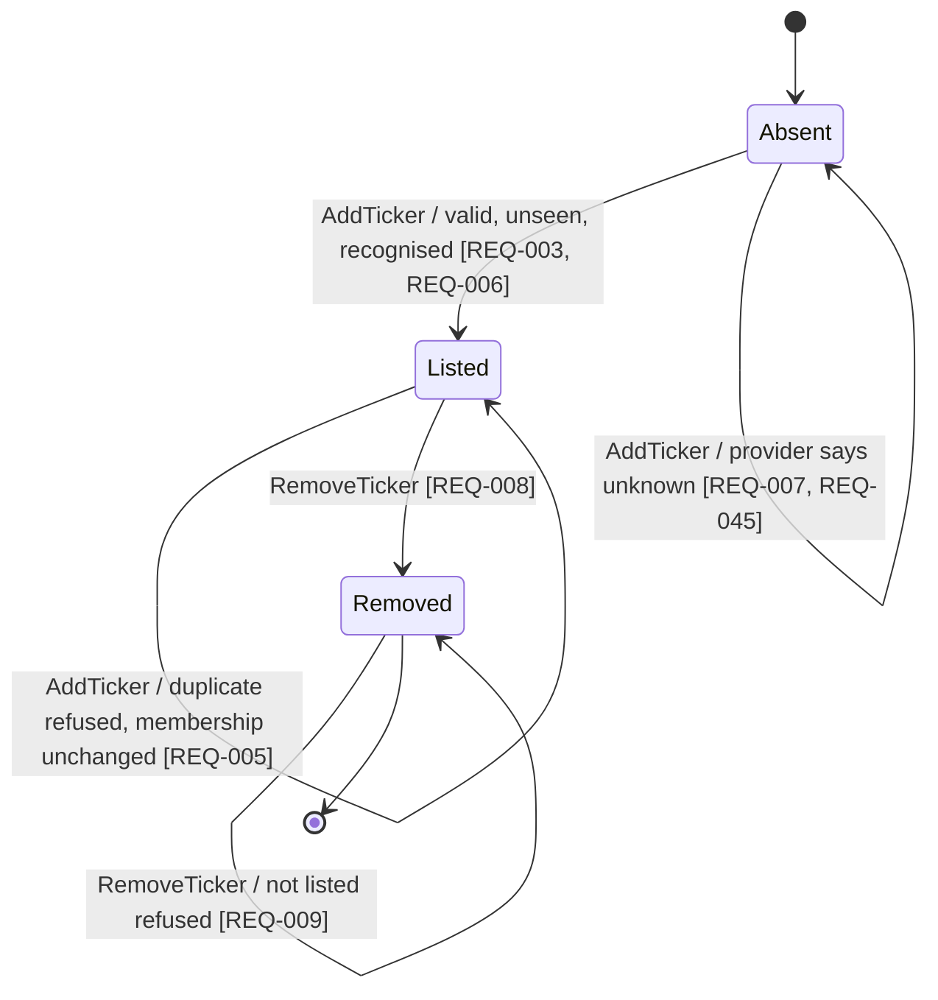
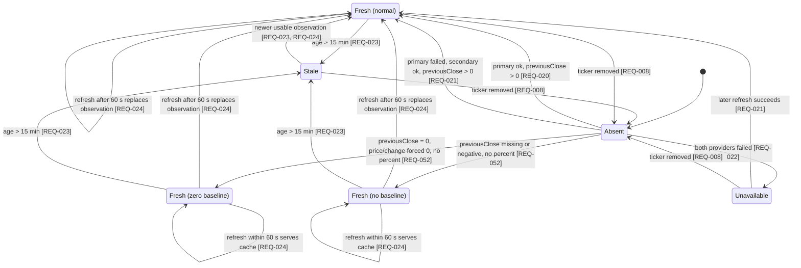
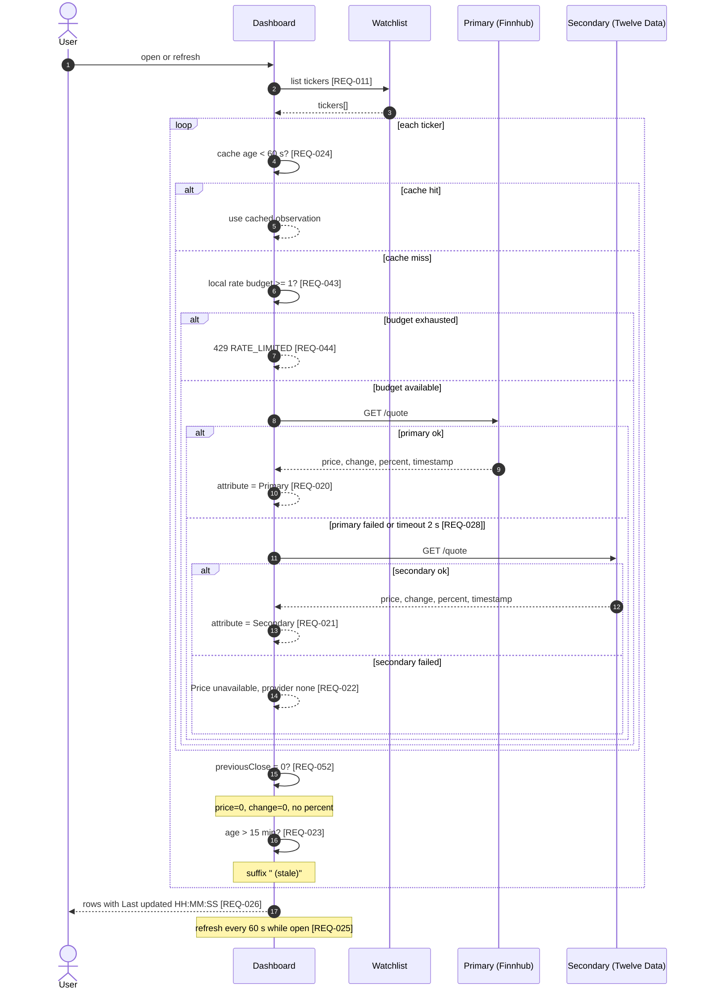
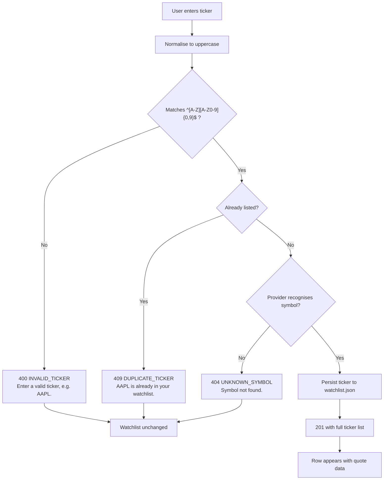
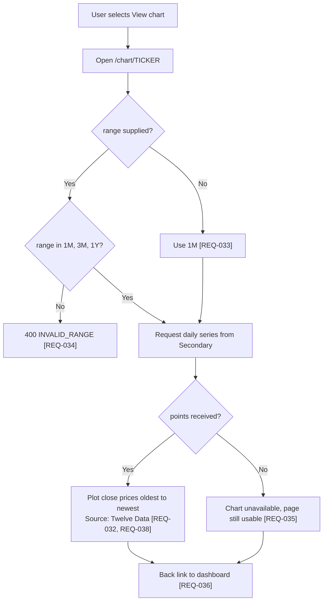

# Phase 2 — Intent Diagrams

Feature: `stock-watchlist`
Version: **v1** (2026-11-16)
Status: Draft, awaiting user approval

Derived only from `Spec/implementation-spec.md` v1.2
(`a37de6e473707f7b`) and `01-domain-model/domain-model.md` (`931f233b964f4305`).
Each transition and exit below cites its `REQ-*`. Any decision without a label would be a
new `AMB`; none is present in v1. The text table after each diagram is the reviewing aid.

## D1 — Watch entry lifecycle (state)

| From | To | Guard | REQ |
| :-- | :-- | :-- | :-- |
| Absent | Listed | valid, unseen, provider-recognised | REQ-003, REQ-006 |
| Absent | Absent | invalid form | REQ-004 |
| Absent | Absent | provider reports unknown symbol | REQ-007, REQ-045 |
| Listed | Listed | duplicate add refused | REQ-005 |
| Listed | Removed | user removes ticker | REQ-008 |
| Removed | Removed | remove of a non-listed ticker | REQ-009 |

No cap transition exists: REQ-013 states there is no maximum size.

## D2 — Quote lifecycle (state)

| From | To | Guard | REQ |
| :-- | :-- | :-- | :-- |
| Absent | Fresh | primary ok, previousClose > 0 | REQ-020 |
| Absent | Fresh | primary failed, secondary ok | REQ-021 |
| Absent | Fresh (zero) | previousClose = 0 | REQ-052 |
| Absent | Fresh (no baseline) | previousClose missing or negative | REQ-052 |
| Absent | Unavailable | both failed | REQ-022 |
| any Fresh | same | refresh inside 60 s | REQ-024 |
| Fresh | Fresh | refresh after 60 s | REQ-024 |
| Fresh | Stale | age > 15 minutes | REQ-023 |
| Stale | Fresh | newer usable observation | REQ-023 |
| Unavailable | Fresh | later refresh succeeds | REQ-021 |
| any | Absent | ticker removed | REQ-008 |

## D3 — Quote retrieval with fallback (sequence)

| Boundary | Failure branch | REQ |
| :-- | :-- | :-- |
| Dashboard → Watchlist | empty list | REQ-001 |
| Dashboard → Primary | non-2xx, timeout, malformed | REQ-028, REQ-042, REQ-046 |
| Dashboard → Secondary | non-2xx, timeout, malformed | REQ-042, REQ-046 |
| both providers | no usable observation | REQ-022 |
| local limiter | budget exhausted | REQ-044 |
| no credentials | `503 MISSING_API_KEY` | REQ-041 |
| cache | inside 60 s | REQ-024 |

## D4 — Add ticker (flowchart)

| Exit | Status | Copy | REQ |
| :-- | :-- | :-- | :-- |
| invalid form | 400 `INVALID_TICKER` | `Enter a valid ticker, e.g. AAPL.` | REQ-004 |
| duplicate | 409 `DUPLICATE_TICKER` | `AAPL is already in your watchlist.` | REQ-005 |
| unknown symbol | 404 `UNKNOWN_SYMBOL` | `Symbol not found.` | REQ-007 |
| accepted | 201 | full list | REQ-006 |
| persistence | — | `$DATA_DIR/watchlist.json` | REQ-010 |

## D5 — Chart page (flowchart)

| Decision | Label | REQ |
| :-- | :-- | :-- |
| no range | default `1M` | REQ-033 |
| invalid range | `400 INVALID_RANGE` | REQ-034 |
| series available | render, source labelled | REQ-032, REQ-038 |
| series unavailable | `Chart unavailable` | REQ-035 |

## Diagram completeness check

| Check | Result |
| :-- | :-- |
| Every transition labelled with a guard | Yes |
| Every failure branch has a labelled exit | Yes (D1 2 exits, D2 3, D3 4, D4 3, D5 2) |
| Every decision node maps to a REQ | Yes |
| New ambiguities introduced by drawing | None |
| Intent vs as-built | As-built is separate, Phase 12 |

**Approval record:** pending user approval of v1. Version and date are recorded in the frozen
plan's provenance at Phase 7. This file is never overwritten; a revision becomes `v2.md`.
