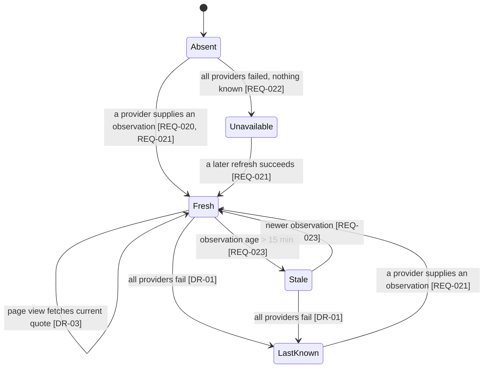

# Phase 2 — Intent Diagrams, v2

Feature: `stock-watchlist`
Version: **v2** (2026-11-17). Supersedes v1 (`v1.md`, unchanged) for the points listed below.
Status: approved by user for the points below, 2026-11-17.

v2 records decisions taken after v1 and after the frozen plan. It does not change any frozen
scenario. Where a point now has no scenario, section 4 lists the coverage gap.

## 1. Decisions

| ID | Topic | Decision | Source |
| :-- | :-- | :-- | :-- |
| DR-01 | Provider failure for a ticker | When all providers fail for a ticker, show the last known quote **only if it is fresh** (at most 15 minutes old). If it is stale, or there is none, show `Price unavailable`. | User 2026-11-17 (rev. 3) |
| DR-02 | Budget exhaustion | 429 only when every ticker needing an upstream call was refused and none was served (option A). | User 2026-11-17, follow-up plan |
| DR-03 | Cache on page views | A dashboard page view fetches current quotes. The 60-second cache serves refreshes (`/api/quotes`). | User 2026-11-17, D-9 |
| DR-04 | Add flow errors | Internal error codes (`PROVIDER_UNAVAILABLE`, `MISSING_API_KEY`, `RATE_LIMITED`) are used internally. Provider responses or messages are never passed through. The user sees only the approved copy. | User 2026-11-17 |
| DR-05 | Invalid range on the chart page | The page shows the `1M` chart with the `1M` control selected. The API still returns 400 `INVALID_RANGE`. | User 2026-11-17 (amended 2026-11-17, rev. 3) |
| DR-06 | Engineering copy | Approved: `Range must be 1M, 3M or 1Y.` for `INVALID_RANGE`; `<TICKER> is not in your watchlist.` for `NOT_IN_WATCHLIST`; `Something went wrong. Try again shortly.` with code `INTERNAL_ERROR` for unexpected errors. | User 2026-11-17 |

## 2. Diagram changes

### D2 Quote lifecycle (changed)

Add the transition for all providers failing after an earlier observation:

`LastKnown` is the last observation, shown only while it is fresh (at most 15 minutes old). Once it
is stale, the ticker moves to `Unavailable` and shows `Price unavailable` (DR-01, rev. 3).

### D3 Quote retrieval (changed)

- Budget exhausted: the ticker is refused for that request. The request fails with 429 only if
  every ticker needing an upstream call was refused and none was served. Otherwise the served
  tickers are returned with 200 (DR-02).
- Page view: the server fetches current quotes. The cache is not used for page views (DR-03).
- All providers fail: the last known observation is served if one exists (DR-01). Otherwise the
  ticker is omitted, and its row shows `Price unavailable` (REQ-022).

### D4 Add ticker (changed)

The add flow maps provider failures to internal codes, never to provider text (DR-04):

| Provider result | Internal code | User copy |
| :-- | :-- | :-- |
| Unknown to all providers that answered | `UNKNOWN_SYMBOL` | `Symbol not found.` |
| No provider can confirm (failure) | `PROVIDER_UNAVAILABLE` | `Data provider is unavailable. Try again shortly.` |
| No key configured | `MISSING_API_KEY` | `Missing API key: set FINNHUB_API_KEY and TWELVEDATA_API_KEY.` |
| Local budget refused | `RATE_LIMITED` | `Too many requests. Try again in N seconds.` |

### D5 Chart page (changed)

- Range `1M` is the default. An invalid range on the page is shown as the default `1M` control,
  selected, with `Chart unavailable` (DR-05).
- The API stays strict: `range` not in `1M`, `3M`, `1Y` is 400 `INVALID_RANGE`.

## 3. Unchanged

D1 (watch entry), the rest of D2 and D3, D5 for valid ranges, and all approved copy in v1 are
unchanged.

## 4. Coverage gaps created by v2

These approved behaviours have no frozen acceptance scenario. Each needs a follow-up plan before
it counts as verified.

| Decision | Gap |
| :-- | :-- |
| DR-01 (last known quote) | No scenario. Needs a follow-up scenario. |
| DR-05 (page range fallback) | No scenario. Needs a follow-up scenario. |
| DR-03 (page view bypasses cache) | No scenario. The behaviour is exercised indirectly by SCN-031, which passes. A follow-up scenario would make it explicit. |
| DR-04 (internal codes) | Covered in part by the existing add-flow scenarios. No change needed. |
| DR-06 (copy) | Not a separate scenario. The copy appears in unit tests (`UT-stock-watchlist-039..050`). |

## 5. Approval record

- Approved by user, 2026-11-17, for DR-01 to DR-06 as listed.
- No change to `specs/stock-watchlist.md` or to the locked test files.
