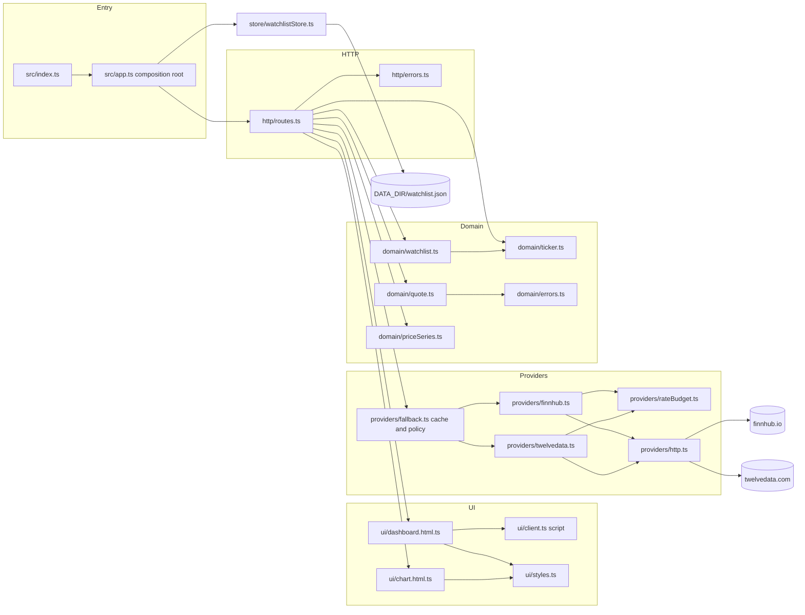

# As-built Diagram and Intent Comparison (Phase 12): stock-watchlist

Compared against: `02-intent-diagrams/v1.md` (approved 2026-11-16), the implementation design,
and the decisions D-3 to D-9. The frozen plan and its tests are the expectation source; this file
only records what was built and where it differs from intent.

## 1. As-built structure

Dependency direction holds: `domain` imports only `domain`. Providers, store, UI, and HTTP depend on
domain and never the reverse.

## 2. As-built flows against intent diagrams

### D1 Watch entry

| Intent | As-built | Status |
| :-- | :-- | :-- |
| Absent to Listed on valid, unseen, recognised ticker | `POST /api/watchlist`, then verify with Finnhub, then Twelve Data | Matches |
| Invalid form stays Absent (400) | `toTicker` before any provider call | Matches |
| Unknown symbol stays Absent (404) | Finnhub `c=0,t=0` or both providers unknown | Matches (GAP-003) |
| Listed to Listed on duplicate (409) | duplicate check before provider call | Matches |
| Listed to Removed | `DELETE /api/watchlist/:ticker` only | Matches, no UI control (D-8) |
| Removed to Removed on unlisted | 404 `NOT_IN_WATCHLIST` | Matches |

### D2 Quote lifecycle

| Intent | As-built | Status |
| :-- | :-- | :-- |
| Absent to Fresh via Finnhub | `fallback.ts` observe | Matches |
| Absent to Fresh via Twelve Data after Finnhub fails | `fallback.ts` observe | Matches |
| Absent to Unavailable (both fail) | ticker omitted, row shows `Price unavailable` | Matches (AMB-007) |
| Fresh refresh inside 60 s serves cache | `/api/quotes` uses cache | Matches (D-9) |
| Refresh after 60 s replaces observation | cache expires | Matches |
| Fresh to Stale after 15 min | `stale` flag and ` (stale)` suffix | Matches |
| Zero baseline and missing baseline | REQ-052 derivation | Matches |
| Unavailable to Fresh later | observation fetched again on the next request | Matches |
| **Not in intent:** last known observation served when all providers fail | `fallback.ts` `lastKnown` | **Drift** (see section 3) |

### D3 Quote retrieval with fallback

| Intent | As-built | Status |
| :-- | :-- | :-- |
| Cache hit inside 60 s, no provider call | yes, except page views (D-9) | Matches with an approved exception |
| Local budget check before each call | `RateBudget.tryAcquire` | Matches |
| Budget exhausted gives 429 | 429 only when every ticker needing a call was refused and none was priced (D-5, FU-002) | **Drift from the intent diagram's simple 429** (approved as option A) |
| Timeout 2 s counts as failure | `fetchJson` `AbortSignal.timeout` | Matches |
| No credentials gives 503 | `MISSING_API_KEY` | Matches |

### D4 Add ticker

| Intent | As-built | Status |
| :-- | :-- | :-- |
| Invalid to 400 `INVALID_TICKER` | yes | Matches |
| Duplicate to 409 | yes | Matches |
| Unknown to 404 `UNKNOWN_SYMBOL` | yes | Matches |
| Accepted to 201 with full list | yes, insertion order | Matches (AMB-011) |
| Persistence to `watchlist.json` | atomic write via temp file and rename | Matches |
| Provider cannot be reached for the add | **Not in intent:** 502 `PROVIDER_UNAVAILABLE` (or 503 with no keys, or 429) | **Drift** (D-4) |

### D5 Chart page

| Intent | As-built | Status |
| :-- | :-- | :-- |
| No range gives 1M | yes | Matches |
| Invalid range gives 400 `INVALID_RANGE` | API returns 400. The page falls back to a default range and shows `Chart unavailable` | Page behaviour is **not in intent** (drift, see section 3) |
| Series from Twelve Data only | yes | Matches |
| Oldest to newest | yes | Matches |
| Unavailable shows `Chart unavailable`; dashboard still usable | yes | Matches |
| Back link | yes | Matches |
| Unlisted ticker still works (AMB-012) | yes | Matches |

## 3. Drift register

| ID | Where | As-built | Intent or plan | Decision | Action |
| :-- | :-- | :-- | :-- | :-- | :-- |
| DR-01 | D2 | Last known observation served when all providers fail | Intent shows Unavailable | Spec §7 says cached data is served regardless of provider availability | Record in intent v2 or accept |
| DR-02 | D3 | 429 only when all needed tickers refused | Intent shows 429 on budget exhaustion | option A (follow-up) | Recorded; intent v2 should match |
| DR-03 | D3, D4 | Cache bypassed on page view | Intent shows cache on every refresh | D-9 | Recorded; intent v2 should match |
| DR-04 | D4 | 502, 503, or 429 on an add the providers cannot confirm | Intent shows only 400, 409, 404 | D-4 | Needs user review |
| DR-05 | D5 | Invalid range on the page falls back to 1M and shows `Chart unavailable` | Intent shows 400 `INVALID_RANGE` on the API only | Not decided | Needs user review |
| DR-06 | Copy | `INVALID_RANGE`, `NOT_IN_WATCHLIST` and `INTERNAL_ERROR` copy is engineering copy | Spec gives none | D-6 | Needs user review |
| DR-07 | UI | No remove control | Intent D1 has removal as a state, not a control | D-8 | Recorded, approved |
| DR-08 | UI | Add form and refresh need JavaScript | Not stated in intent | Not decided | Accessibility note in report |
| DR-09 | Structure | `render.ts` absent; styles and client as TS strings | Design §3 lists `render.ts`, `styles.css`, `client.ts` | D-3 | Recorded; design review requested |

## 4. Intent v2

`02-intent-diagrams/v2.md` records all decisions. Decisions:

- DR-01 last known quote: approved; the build already does this.
- DR-02 budget rule and DR-03 page-view cache: approved; the build already does this.
- DR-04 internal codes: approved; the build maps provider failures to internal codes with fixed copy.
- DR-05 invalid page range: approved as the first option, which is the as-built behaviour.
- DR-06 copy: approved.

Intent v1 stays unchanged.

## 5. Completion status

- Phase 10 gates: pass (see `10-verification/report.md`).
- Phase 11 accessibility: pass for the contract locators probed; JavaScript dependency noted.
- Phase 12 as-built comparison: complete. All drift items are decided.
- Traceability: DR-01, DR-03 and DR-05 are covered by follow-up 02 (frozen, locked, passing).
  DR-06 copy is covered by unit tests. No open traceability gap remains.
- Decision D-10 (cache drop on failed fresh fetch) confirmed by the user, 2026-11-17.
- Latest full run: 69 pass, 2 fail (original SCN-047 and SCN-050, superseded by follow-up 01 and
  blocked in the original plan).
